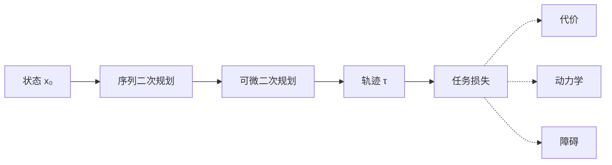

# DiffMPC-CBF

把安全约束写进可微的模型预测控制。

每个控制周期，求解器在有限时域上优化一条状态–控制轨迹：动力学是等式，控制障碍函数与输入上下界是不等式。序列二次规划把这个问题逐次化成二次规划；收敛后的最后一次求解经过可微 QP 层，任务损失因此能够更新代价、动力学与障碍函数里的参数。

## 问题

给定当前状态 $x_0$，在时域 $T$ 上求解

$$
\begin{aligned}
\min_{x,u}\quad
& \sum_{t=0}^{T-1} \ell(x_t, u_t) + \ell_T(x_T) \\
\mathrm{s.t.}\quad
& x_{t+1} = f(x_t, u_t), \\
& h(x_{t+1}) \ge (1-\gamma)\, h(x_t), \\
& u_{\min} \le u_t \le u_{\max}.
\end{aligned}
$$

$h$ 是控制障碍函数，$\gamma \in (0,1]$ 决定安全集向前收缩的速率。障碍不等式带松弛，约束暂时过紧时仍返回一条可执行的控制。

## 求解

一次前向做三件事。

1. **热启动。** 用上一拍轨迹平移作为初值，再按动力学铺开名义轨迹。首拍则从零控制出发。
2. **序列二次规划。** 在当前轨迹上组装代价的梯度与 Hessian、动力学与障碍的雅可比，求解二次规划得到搜索方向，并沿价值函数做线搜索，直到轨迹与乘子稳定。
3. **可微收尾。** 在收敛点再解一次二次规划。前向给出当前要执行的控制，反向把梯度送回 `nn.Module` 的参数。

无障碍的线性二次与非线性调节问题走另一条路径：`diffmpc_cbf.lqr.DiffMPC` 用迭代 LQR 求解，梯度可与 `thirdparty/mpc_pytorch` 对照。



## 接口

代价、动力学与障碍都是 `torch.nn.Module`。写下函数本身即可，一阶与二阶导数由自动微分生成。二次代价 `QuadCost` 与线性动力学 `LinDynamic` 则直接给出解析导数。

| 基类 | 实现 | 角色 |
| --- | --- | --- |
| `Cost` | 阶段代价、终端代价 | $\ell,\ \ell_T$ |
| `Dynamic` | 状态转移 | $x^+ = f(x,u)$ |
| `Barrier` | 障碍函数 | $h(x)$ |

轨迹放在 `Tau` 里：`tau.x` 为状态序列，`tau.u` 为控制序列。求解器在每个时刻向参数字典注入时间索引 `t`。

```python
from diffmpc_cbf import DiffMPCBF

mpc = DiffMPCBF(
    nx, nu, nb, T,
    batch_size=1,
    cost=cost,
    dynamic=dynamic,
    barrier=barrier,
    umin=umin,
    umax=umax,
)

tau = mpc(x0, {
    "cost": {"pref": pref},
    "dynamic": {},
    "barrier": {"gamma": gamma, "obs_info": obs_info},
})
u = tau.u[0]
```

`loss.backward()` 穿过最后一次二次规划，更新代价、动力学与障碍内部的网络。

## 示例

| 目录 | 系统 | 内容 |
| --- | --- | --- |
| `examples/tvto` | 平面双积分器，含未知阻尼 | 主示例。在两个运动圆形障碍之间跟踪目标。上下文网络调节代价权重，残差网络补偿阻尼，裕度网络修正安全半径。 |
| `examples/sp` | 一维非线性振子 | 解析代价与动力学，对照迭代 LQR。 |
| `examples/spnn` | 同上 | 代价权重与动力学残差改为网络。 |
| `examples/lc` | 时变线性二次系统 | 与 mpc.pytorch 对照控制量，以及对代价、动力学参数的梯度。 |

`tvto` 的训练损失含四项：位置跟踪、控制能耗、障碍违反、预测状态与环境真实状态的偏差。

```bash
cd examples/tvto
uv run python main.py
```

日志写在运行目录下的 `log/train.txt`。

## 环境

Python 3.11。依赖 PyTorch、NumPy、Matplotlib，可微二次规划由仓库内的 [qpth](thirdparty/qpth) 提供。

```bash
uv sync
```

## 布局

```
src/diffmpc_cbf/          求解器、代价、动力学、障碍与轨迹
examples/                 由简到繁的四个算例
thirdparty/qpth           可微二次规划
thirdparty/mpc_pytorch    可微迭代 LQR 参考实现
refpaper/                 可微 MPC、OptNet 与序列二次规划
```

## 参考文献

- Brandon Amos, Ivan Jimenez, Jacob Sacks, Byron Boots, J. Zico Kolter. *Differentiable MPC for End-to-end Planning and Control.* NeurIPS, 2018.
- Brandon Amos, J. Zico Kolter. *OptNet: Differentiable Optimization as a Layer.* ICML, 2017.
- Aaron D. Ames, Samuel Coogan, Magnus Egerstedt, Gennaro Notomista, Koushil Sreenath, Paulo Tabuada. *Control Barrier Functions: Theory and Applications.* ECC, 2019.

可微 MPC 与 OptNet 的 PDF 见 `refpaper/`，同目录另附序列二次规划文献。
